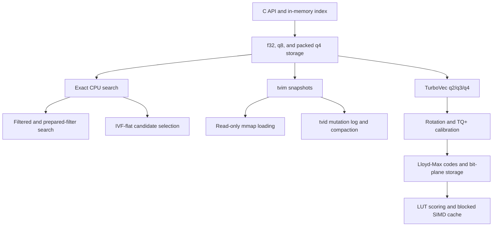

# Vector Index

`ggml-vector-index` is an opt-in C API for local vector search. It stores caller
provided ids with dense vectors and exposes exact top-k search over f32, q8, and
packed q4 storage.

This candidate component is currently standalone. It is not enabled in default
builds and is not wired into the llama runtime, server, or app paths. Consumers
should enable it explicitly and link the vector-index target directly.

## How The Pieces Fit

The vector index is organized as layers. The storage, search, and persistence
layers are general vector-index infrastructure; TurboVec is the q2/q3/q4
algorithm built on top of them.



The public C API owns the opaque index handle, caller-provided ids, vector
slots, mutations, and the top-k result contract. f32 storage and exact search
form the correctness baseline used to validate compressed or approximate paths.

Generic q8 and packed q4 modes reduce memory used by CPU-resident vectors. Each
vector stores an f32 scale, and search scores f32 queries directly against the
quantized codes. These modes also provide comparison points for TurboVec
quality and performance.

Exact search scans every live slot. Filtered search restricts that scan to a
caller-provided id set, while prepared filters cache the id-to-slot mapping for
repeated queries. IVF-flat reduces the number of vectors scored by assigning
vectors and queries to in-memory centroid lists. It is an optional search
accelerator and does not change the storage format.

A `.tvim` file is a complete index snapshot. Normal loading materializes the
index in memory, while mmap loading keeps supported vector sections mapped
read-only for faster startup and lower memory duplication. A `.tvid` file
records incremental add and remove operations after a snapshot. Replay
reconstructs the latest state, and compaction replaces the snapshot and resets
the log. State identities and file locking prevent stale or concurrent writers
from silently producing a divergent index.

If compaction replaces the snapshot but cannot confirm its durability or reset
the delta log, it returns `GGML_VEC_INDEX_E_PARTIAL_COMPACT`.

TurboVec is a separate compressed search mode built on the same index API: a
port of upstream [turbovec](https://github.com/ryancodrai/turbovec) 1.1.2 that
encodes, snapshots and syncs byte for byte as turbovec does. Vectors and
queries are rotated into a quantization-friendly space, optional TQ+
calibration and Lloyd-Max codebooks produce q2, q3 or q4 codes stored in
bit-plane rows, and search builds lookup tables from the rotated query to score
packed codes without reconstructing full vectors. Codes are kept in a 32-vector
blocked layout that scalar, NEON, and AVX2 scoring read directly. Derived
rotation and IVF state is invalidated or rebuilt after mutations, compaction,
and snapshot loading.

Each layer carries its own regression coverage: result ordering, architecture
parity, snapshot corruption, mmap restrictions, delta replay, compaction, stale
writers, hardlink aliases, torn-header recovery, cross-process locking,
TurboVec golden fixtures, cache invalidation, benchmark coverage, and package
smoke tests.

## Build

Enable the library with `GGML_VECTOR_INDEX`:

```sh
cmake -B build -DGGML_VECTOR_INDEX=ON -DLLAMA_BUILD_TESTS=ON
cmake --build build --target ggml-vector-index test-vector-index
```

Installed CMake packages export the target as `ggml::vector-index`.

```cmake
target_link_libraries(my_target PRIVATE ggml::vector-index)
```

NEON kernels are selected automatically on supported ARM builds. On x86,
the AVX2 and AVX-512 kernels (BW, VBMI, VNNI, GFNI and VPOPCNTDQ forms, each
in its own object) are built whenever the compiler supports them and are
selected after a runtime CPU check; a CPU without one uses that kernel's
scalar model, which computes the same result. Scalar and SIMD reduction
order can produce small score differences across CPU architectures.

## Storage Modes

Create an index with a fixed dimension and bit width:

- `bit_width=32`: full f32 vectors.
- `bit_width=8`: per-vector symmetric q8 storage with f32 scales.
- `bit_width=4`: per-vector symmetric packed q4 storage with f32 scales.

The generic q4/q8 layouts are local to vector-index and are not `ggml-quants`
block formats. They keep one scale per external vector for random row lookup,
delete/compact operations, and snapshot round trips.

`ggml_vec_index_create_turbovec(dim, bit_width)` creates a TurboQuant index
with 2-, 3- or 4-bit codes on 64-bit targets, for positive dimensions up to
16384 that are multiples of 8 (`ggml_vec_index_create_turbovec_q2` and
`_q4` are shorthands). Codes are stored in bit-plane rows with one
score-correction scale per vector; a reconstruction too degenerate to score
stores scale 0 rather than an inflated one. Vectors and queries use upstream
turbovec's deterministic rotation: two rounds of a ChaCha8-seeded global
permutation, sign flip and normalized Walsh-Hadamard transform over the largest
power-of-two block of `dim`, computed with a fixed operation order and no fused
multiply-add, so encoded bytes are identical on every target.

TQ+ calibration is explicit. `ggml_vec_index_turbovec_calibrate` fits a
per-coordinate shift and scale from a sample of vectors and commits it; every
later add is encoded under it, and rows already stored are re-encoded from
their codes. Pass a random, representative sample of about 1000 vectors, and
calibrate before adding when possible: re-encoding stored rows is a second
quantization. An index that is never calibrated is plain TurboQuant.
`ggml_vec_index_prepare` is best-effort and does not report allocation status.

Like upstream, search picks its arithmetic by host. On aarch64 with the
dot-product extension, and on x86 with AVX-512 F, BW, VBMI and VNNI, 4-bit
codes are scored with upstream's int8 permute-dot arithmetic over upstream's
vector-major block layout; the two architectures sum the same integers, so
their scores agree. On such an x86 host 2- and 3-bit codes take the
vector-major layout too and are scored as upstream's `vpermb` scan scores
them: an exact sum of the lookup-table entries, then one multiply and one
add. Everywhere else codes are scored through the nibble lookup tables,
whose partial sums are folded in every 256 byte groups. These round
differently, so scores, and occasionally which ids sit at the edge of a
top-k, depend on the host exactly as upstream's do.
`TURBOVEC_NO_VECTOR_MAJOR` (or the older `TURBOVEC_NO_VNNI`) set to anything
but `0`, read once per process, keeps the lookup tables for new indexes, and
`TURBOVEC_NO_GFNI` keeps the x86 permute-dot kernel off its GFNI form (the
same sums), as upstream's do.

On aarch64 with the int8 matrix-multiply extension (i8mm) as well, a 4-bit
index whose dimension is a multiple of 16 takes upstream's wider `vm8`
block layout, and the queries of a multi-query search are scored in fused
batches of 12, 8 or 4 with SMMLA kernels, as upstream does (other dimensions
batch with SMMLA over the vector-major layout). Permute-dot sums are exact
integers, so every kernel returns the same scores. The block layout is
chosen when an index is created and never reaches a file: snapshots are
written from sequential rows. `TURBOVEC_NO_I8MM` set to anything keeps the
SDOT kernels and the vector-major layout, as upstream's does.

`TURBOVEC_2BIT_VM8=1` in the environment, read once per process, opts in to
upstream's experimental 2-bit `vm8` path, with upstream's semantics: on an
i8mm host, a 2-bit index whose dimension is a multiple of 32 takes the `vm8`
layout, and batches of 12, 8 or 4 queries (filtered searches included) score
it with int8 SMMLA arithmetic, which rounds differently from the lookup
tables a single query and any query outside a batch still use. On aarch64
the variable also turns off staged search at 2 and 4 bits. Results then
match upstream run with the same variable; any other value leaves search
unchanged.

Large 2- and 4-bit indexes search in stages, as upstream does. From 32,768
vectors, at dimensions that are multiples of 32, on aarch64 (4 bits also needs
the dot-product extension; neither runs under `TURBOVEC_2BIT_VM8=1`) and on
x86 hosts with the vector-major layout, a search scans the sign planes alone for a
shortlist (`max(384, 16k)` at 2 bits; `max(256, 20k)`, or `16k` from `k = 64`,
at 4 bits), ranks the shortlist with estimates that add the lower planes,
and rescores the best few with the full scan's own arithmetic. Returned
scores are exactly the full scan's, but which ids are returned can differ
from it: on unstructured random test data 77 to 94% of a top 10 overlaps the
full scan's, the same as upstream, and real embeddings fare better (see
upstream's measurements). The results match upstream's single-threaded
staged search bit for bit, ties included, down to the batch query whose
sampled seed comes up short and is rescanned with single-query tables.
Upstream's thread-pool variant refines inside its scan and can return
different ids; here a lone query over 32,768 or more vectors splits its scan
across the index's threads without changing any result. An index stays
staged if it later shrinks below the threshold.
`ggml_vec_index_turbovec_set_staged(idx, 0)` makes an index scan in full
instead. On x86, as upstream does, the sign planes are scanned with the
`vpermb` arithmetic, the shortlist is ranked by counting bit masks against the
query rather than through lookup tables, and a 4-bit shortlist is rescored
straight from the bit planes. No fixture from upstream x86 covers those
results; they are checked against reference implementations of upstream's
arithmetic.

A TurboVec 1.x index holds its codes once, in the 32-vector blocked layout that
search scores, so it uses about half the code memory of upstream turbovec,
which keeps bit-plane rows next to its search cache. A staged index also keeps
the bit-plane rows and a blocked copy of its sign planes, because its
shortlist ranking reads the planes row by row. Adds and removals patch the
blocked codes in place; calibration and snapshot loading rebuild them. Legacy
v3 indexes keep bit-plane rows next to the blocked copy.

Indexes loaded from a v3 snapshot (written by earlier releases) keep the
turbovec 0.9 encoding they were written with: a dense Gaussian QR rotation,
dimensions up to 1024 for add and search, and TQ+ calibration fitted
automatically on a first add of at least 1000 vectors. They keep writing v3
and reject calibrate, sync and in-memory snapshots.

Search scores are dot products. The index does not normalize vectors internally.
For cosine similarity, normalize vectors before insertion and normalize queries
before search.

## Search Modes

- Exact search (`ggml_vec_index_search`) scans every live slot.
- Filtered search (`ggml_vec_index_search_filtered`) restricts that scan to
  caller-provided ids.
- Prepared-filter search (`ggml_vec_index_filter_create` and
  `ggml_vec_index_search_prepared_filtered`) caches the id-to-slot mapping for
  repeated calls. The source index must outlive the filter, and the filter may
  be used only with that same index handle. An `add` that inserts one or more
  vectors, a successful `remove`, or a `compact` that removes tombstones makes
  the filter stale. Subsequent searches with it return
  `GGML_VEC_INDEX_E_INVALID_ARG`.
- IVF-flat search (`ggml_vec_index_build_ivf` and
  `ggml_vec_index_search_ivf`) builds heap-owned state for approximate candidate
  selection. Call `ggml_vec_index_build_ivf` before the first IVF search.
  Rebuild it after loading an index, after an `add` that inserts one or more
  vectors, after a successful `remove`, and after a `compact` that removes
  tombstones. Until it is built or rebuilt, IVF search returns
  `GGML_VEC_INDEX_E_INVALID_ARG`. `nprobe` must be at least 1. Lower values
  search fewer lists and may return different results from exact search.
  Probing at least the number of built lists searches all lists, so candidate
  coverage matches exact search. IVF state is not persisted in snapshots.

`ggml_vec_index_prepare` is an optional cache warmup for TurboVec rotation and
codebook state; other storage modes ignore it. New callers should
use `ggml_vec_index_build_ivf` when approximate-search preparation is needed.

Higher `nprobe` values search more lists and generally improve recall at higher
cost. IVF uses the same dot-product score as exact search, assigning vectors and
queries to arithmetic centroids with dot-product scoring. Low `nprobe` values
are a recall/latency heuristic; probing all built lists gives exact-search
candidate coverage. For cosine-like IVF behavior, normalize vectors before
insertion and normalize queries before search.

## Persistence

Snapshots use `.tvim`. Version 2 records the storage kind, ids, quantization
scales, vector bytes, and CRC32C checksums for accidental corruption detection.
The loader still accepts legacy v1 f32 snapshots; legacy `bit_width=8` files
are quantized to q8 on load.

`ggml_vec_index_load_mmap` maps the vector section of a version 2 snapshot
read-only and copies ids and scales into memory. Legacy v1 snapshots require
`ggml_vec_index_load`. Mmap-loaded handles allow search and IVF preparation,
but reject content mutations. Mmap loading requires a little-endian host because
mapped vector bytes are read directly; use `ggml_vec_index_load` on big-endian
hosts. On POSIX, the snapshot filesystem must support `flock`.

Delta logs use `.tvid`. Legacy v1 delta logs use a full-index CRC32C state
field. Replay validates every record CRC and checks the full legacy state once
at the committed tail. Newer logs use rolling state tokens, and v4 logs store
the full rolling state in each record. New logged mutations require v4; legacy
logs remain replay-only.

An index loaded with `ggml_vec_index_load_with_delta` is bound to that delta
log. Plain `add`, `remove`, `compact`, and snapshot `write` operations return
`GGML_VEC_INDEX_E_INVALID_ARG` on the bound handle.

`ggml_vec_index_add_logged` and `ggml_vec_index_remove_logged` append durable
mutations. Before starting a new log, establish the snapshot lineage with a
successful durable `ggml_vec_index_write` or a `ggml_vec_index_load`. The first logged
mutation binds the handle to the delta log; later logged mutations and
`ggml_vec_index_compact_delta` must use that same file. Equivalent hardlink
aliases identify the same log.

An I/O or durability failure can occur after a complete record was written. In
that case the in-memory mutation remains applied, and the handle may reject
later logged mutations and delta compaction with `GGML_VEC_INDEX_E_IO`. Reload
the snapshot and delta log to revalidate the durable state before continuing.
`GGML_VEC_INDEX_E_NOT_DURABLE` means the record data was synced but directory
durability could not be confirmed. `GGML_VEC_INDEX_E_PARTIAL_COMPACT` means the
snapshot was replaced but its durability could not be confirmed, or resetting
the delta log failed.

`ggml_vec_index_write_with_durability` with `GGML_VEC_INDEX_DURABILITY_FAST`
writes the same snapshot through the same temp file and atomic rename but
skips the data and directory fsyncs, as upstream turbovec's `Durability::Fast`
does. The destination never holds a torn snapshot and survives a process
crash, but a power loss shortly afterwards may lose the new file, so a fast
write does not let a delta log start. Syncs are always durable.

TurboVec snapshots use upstream turbovec's v8 container, the `.tvim` files
turbovec's own `IdMapIndex` writes: a superblock with the codebook and
calibration, two commit header slots, and one unit per 32-row block. Files are
interchangeable with turbovec 1.1 and later in both directions; v7 files and
v8 files in the bit-planes unit layout load too, and positional `.tv` files
(no ids) are rejected. Removal is upstream's swap-remove (the last row moves
into the hole), so a snapshot is byte-identical to the one turbovec writes
for the same history. Like turbovec, an index that would search in stages at
its current size stores its block units in the bit-planes layout and every
other index in the sequential one; both forms load in either
implementation.
Each header slot reserves room for 1024 pending removals, so even a small file
carries a few hundred KiB of zero padding; the writer leaves it as a file hole
where the filesystem supports one. v8 carries no checksum over the block
codes, only over the superblock and headers. Loading validates the codebook,
calibration and per-vector scales and rejects duplicate ids. TurboVec
snapshots do not support mmap loading or delta logs.

Writers build block units as they go: a write or full sync holds about 1 MiB
beyond the index, and `ggml_vec_index_to_bytes` holds only its output. A load
reads the file's declared content and decodes it straight into the blocked
codes.

`ggml_vec_index_to_bytes` and `ggml_vec_index_from_bytes` move the same image
through memory, and `ggml_vec_index_serialized_size` reports its size.

`ggml_vec_index_sync` saves a TurboVec index incrementally, as turbovec's
`sync` does. The first sync to a path, and the first after a calibrate, writes
the whole file and claims it with a random nonce. Later syncs write only the
appended or changed block units plus one commit header and make them durable
with a single fsync; removals inside committed blocks ride the header as redo
ops. Each header names the units its sync wrote and their digest, so a commit
that reached disk before its data is detected and loading falls back to the
previous commit: a sync torn at any byte leaves a loadable file. Loading a
synced file binds the index to it so syncs continue incrementally. A sync
refuses, with `GGML_VEC_INDEX_E_IO`, a file another writer has advanced; load
the file to adopt its state. Use one writer per path.

Delta logs are bound to the state of the snapshot they extend. Use one evolving
writer handle for a given snapshot and delta path pair. If another handle or
process writes to the same log, stale writers catch up automatically when their
current state matches a committed intermediate log state. Otherwise, reload
from snapshot plus delta before appending again. A bound handle rejects logged
mutations or compaction with a different delta path. A successful catch-up
remains applied if the requested mutation then returns a duplicate or not-found
error. Loading validates each replayed record against its stored post-state
identity.

Cross-process append protection uses cooperative OS file locks. Keep `.tvid`
delta logs on local filesystems with reliable locking, and do not edit or append
to them outside the vector-index API.

After a handle has been loaded with a delta log or has used logged mutations,
content changes must continue through `ggml_vec_index_add_logged`,
`ggml_vec_index_remove_logged`, or `ggml_vec_index_compact_delta`. Plain
add/remove/compact calls and ordinary snapshot writes are rejected on
delta-bound handles.

Readers still accept legacy v1/v2 delta logs. New q4/q8 adds are not appended
to those f32-payload log formats; compact first so subsequent quantized adds use
native-code v4 records.

## mmap Loading

`ggml_vec_index_load_mmap` loads a v2 snapshot with the vector section mapped
read-only. Ids and quantization scales are copied into memory.

On mmap-backed handles:

- Search APIs are allowed.
- `ggml_vec_index_build_ivf` is allowed because it only builds heap-owned search
  state.
- Index-content mutations such as add, remove, compact, and logged mutations
  return `GGML_VEC_INDEX_E_INVALID_ARG`.
- `ggml_vec_index_write` is allowed only when writing to a path different from
  the mapped source file and the handle is not delta-bound.
- `ggml_vec_index_compact_delta` is allowed when writing the compacted snapshot
  to a path different from the mapped source file; it rebuilds the state identity
  before replacing the delta log.

The mmap loader is snapshot-only and does not replay `.tvid` delta logs. Use
`ggml_vec_index_load_with_delta` when delta replay is needed.

The persisted formats are little-endian. Regular load paths decode fields into
host values; mmap loading requires a little-endian host because vector bytes are
read directly from the mapped file.

## Threading

Read-only APIs on the same handle can run concurrently. Mutations, persistence
writes, compaction, and IVF builds are serialized with reads and with each
other. The caller must keep index and prepared-filter handles alive for the full
duration of every API call that uses them.

## Tests and Benchmark

Run the regression tests:

```sh
cmake --build build --target test-vector-index test-vector-index-faults
./build/bin/test-vector-index
./build/bin/test-vector-index-faults
```

Run the synthetic benchmark:

```sh
cmake --build build --target bench-vector-index
./build/bin/bench-vector-index
```

The benchmark reports q8/q4 quality against f32 exact search, exact and IVF
latency, mmap load timing, delta replay/compaction timing, and delete-heavy
behavior.
